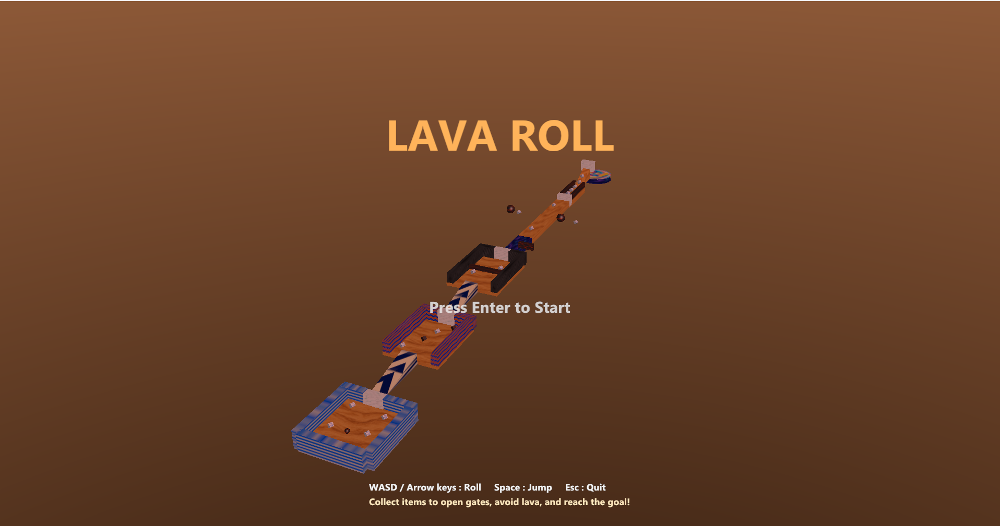

# Lava Roll

溶岩の上に浮かぶコースを、ボールを転がしてゴールまで進む 3D アクションゲームです。
DirectX 12 で自作したゲームエンジンで作っています。

A 3D ball-rolling game over a sea of lava, built on a custom DirectX 12 engine with an in-game editor.



---

## ダウンロードと遊び方

1. [Releases](../../releases) から `LavaRoll.zip` をダウンロードして展開します
2. `LavaRoll.exe` をダブルクリックします
3. タイトル画面で **Enter** を押すとスタートします

### 操作方法

| キー | 動作 |
|---|---|
| W A S D / 矢印キー | ボールを転がす（画面の奥が前） |
| Space | ジャンプ |
| Enter | スタート／ゴール後にもう一度 |
| Esc | ゲームを終了 |

### ルール

- アイテムを集めると、同じグループのゲートが沈んで先へ進めるようになります
- 溶岩（Damage）に触れたり、コースから落ちたりすると、少し前の場所に戻されます（Respawn）
- ゴールに触れるとクリアです。左上のタイムで、速さを競ってください

### 動作環境

- Windows 10 / 11（64bit）
- DirectX 12 に対応した GPU
- 起動しない場合は、[Microsoft Visual C++ 再頒布可能パッケージ（x64）](https://learn.microsoft.com/ja-jp/cpp/windows/latest-supported-vc-redist) をインストールしてください

---

## エンジンの主な機能

- **描画**：DirectX 12、Lambert 拡散反射 ＋ Blinn-Phong 鏡面反射、テクスチャのくり返し・スクロール（流れる溶岩）、自発光（Emissive）
- **背景の空**：画面全体をおおう三角形1枚を描き、見ている方向からグラデーション／パノラマ画像の色を計算
- **物理**：速度と摩擦による転がり、ジャンプと重力、坂を転がり落ちる加速、壁との当たり判定（押し戻しと跳ね返り）
- **当たり判定**：球・向きのついた箱（OBB）・三角形メッシュ（Blender で作った坂など）
- **ギミック**：アイテム、ゲート、ダメージ、ゴール、円を描いて回る物体（Orbit）、その場で回る物体（Spin）
- **エディタ**：Inspector での配置・編集、クリックでの選択（レイによるピッキング）、自由に動かせるカメラ、ステージの保存・読み込み

---

## エディタとして起動する

`--editor` を付けて起動すると、エディタになります。

```
LavaRoll.exe --editor
```

Visual Studio から起動するときは、プロジェクトのプロパティ →「デバッグ」→「コマンド引数」に `--editor` と書いてください。

| 操作 | 動作 |
|---|---|
| 左クリック | 物体を選ぶ（何もないところで選択解除） |
| 右ドラッグ | 視点を回す |
| W A S D Q E | 選んだ物体を動かす（Move Camera が ON ならカメラ）。Shift でゆっくり |
| Esc | 選択解除 |
| Inspector の Play / Stop | プレイの開始・終了（終了すると配置は元に戻る） |

ステージは `res/stage/stage1.txt` に保存されます（エディタを終了したときにも自動で保存）。

---

## ビルド方法

1. Visual Studio 2022（C++ によるデスクトップ開発）を用意します
2. `project/Last.sln` を開きます
3. NuGet（DirectXTK12）と vcpkg（assimp）のパッケージは、ビルド時に自動で取得されます
4. 「Release | x64」でビルドします
5. 配布用の zip を作るときは、`make_dist.bat` をダブルクリックします（`dist/LavaRoll.zip` ができます）

### フォルダ構成

```
include/   ヘッダー
src/       ソースコード
project/   Visual Studio のプロジェクトとシェーダー（*.hlsl）
res/       モデル（model）・テクスチャ（texture）・ステージ（stage）
imgui/     Dear ImGui
docs/      ドキュメントと画像
```

---

## クレジット

- テクスチャ：ChatGPT で生成
- [Dear ImGui](https://github.com/ocornut/imgui)（MIT License）
- [Open Asset Import Library (assimp)](https://github.com/assimp/assimp)（BSD 3-Clause License）
- [DirectX Tool Kit for DirectX 12](https://github.com/microsoft/DirectXTK12)（MIT License）
- フォント：Windows に標準で入っている Segoe UI を使用（配布物には含めていません）
